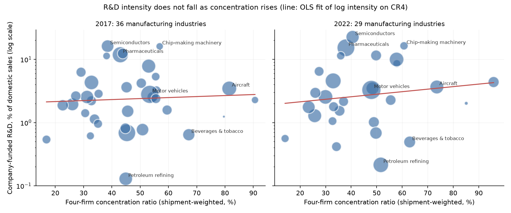
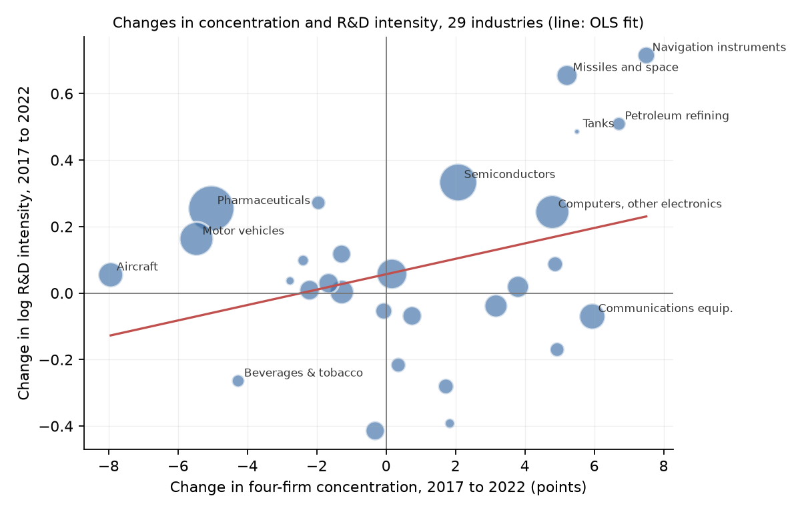

# The Profit You Already Have

### In 1962, Kenneth Arrow argued that a protected monopolist has less reason to invent than a competitive industry, because every improvement replaces profit it already earns. I asked whether American manufacturing looks that way today.

---

For every $100 of goods that American drug makers such as Pfizer, Merck and Eli Lilly sold at home in 2022, they
spent $15.27 of their own money on research done in the United States. Chip companies such as Intel, Texas
Instruments and Micron spent $22.60. Oil refiners such as Marathon, Valero and Phillips 66 spent 21 cents, and the
beverage and tobacco makers, Altria and Coca-Cola among them, spent 49 cents. Those figures come from the National
Science Foundation's annual survey of business research, and the gap between the top and the bottom of the list is
more than a hundredfold.

Some of that gap is chemistry and physics. There is more left to discover about a cancer drug than about a barrel of
diesel. But economists have argued for more than sixty years about a second explanation, which is that the amount
a company spends on invention depends on how much competition it faces. One side holds that only firms with market
power can afford to invent. The other side, whose sharpest statement came from Kenneth Arrow, holds that market
power blunts the urge to invent, because a firm that already earns a monopoly profit has less to gain from a better
method than a firm that earns nothing from the old one.

---

## Three measures

The first measure is how much of its revenue an industry puts back into research. For industry $`j`$,

```math
\text{R\&D intensity}_j = \frac{\text{company-funded R\&D}_j}{\text{domestic sales}_j}
```

The survey counts research a company both paid for and performed in the United States, and sales of the companies
that do research. Semiconductor and electronic component makers paid for $47,380 million of their own domestic
research in 2022, on domestic sales of $209,620 million.

```math
\frac{47{,}380}{209{,}620} = 0.226 = 22.6\%
```

The second measure is how concentrated the industry is. The Census Bureau's Economic Census reports, for each of
roughly 350 manufacturing industries, the share of shipments made by the four largest companies. Writing
$`s_{1j}, \dots, s_{4j}`$ for the four largest market shares in industry $`j`$,

```math
\text{CR4}_j = s_{1j} + s_{2j} + s_{3j} + s_{4j}
```

The research survey's industries are broader than the Census industries, so for each survey industry I average the
CR4 of the Census industries inside it, weighting each by its shipments. For aircraft, engines and parts in 2022,
a group led by Boeing, GE Aerospace and RTX, that average is 73.6%. For printing it is 14.1%.

The third measure comes from Arrow's paper itself. It asks how much a monopolist would value a small cut in its
production cost, compared with what an inventor could earn by licensing the same cut to a competitive industry.
Arrow showed that for a small invention the answer is the ratio of the two outputs, $`x_m / x_c`$, because a cost
saving is worth more when it applies to more units. If demand has a constant elasticity, the monopolist's markup
pins that ratio down. With $`L`$ the Lerner index, the share of the price that is margin over cost,

```math
\frac{x_m}{x_c} = (1 - L)^{1/L}
```

Census figures on value added, payroll and shipments give a rough margin for each industry. For pharmaceuticals in
2022 that margin is 0.568.

```math
(1 - 0.568)^{1/0.568} = 0.432^{1.761} = 0.228
```

Read literally, a single drug monopolist with that margin would value a small cost saving at less than a quarter of
what it is worth to a competitive industry. Under constant-elasticity demand the ratio stays below 0.37 however thin
the margin, because a monopolist always restricts output by at least that much.

| Market | Output relative to competition | Value of a small cost cut relative to competition |
|---|---|---|
| Competitive industry | 1 | 1 |
| Monopolist facing a straight-line demand curve | 1/2 | 1/2 |
| Monopolist with a 50% margin and constant-elasticity demand | 1/4 | 1/4 |

---

## Kenneth Arrow's question

The National Bureau of Economic Research published Kenneth Arrow's "Economic Welfare and the Allocation of
Resources for Invention" in *The Rate and Direction of Inventive Activity*, a 1962 volume from Princeton University
Press. The paper lists his affiliation as the RAND Corporation, although he spent most of his career at Stanford.
Ten years later, at 51, he became the youngest winner of the Nobel Memorial Prize in Economic Sciences, which he
shared with John Hicks. He retired from Stanford in 1991 and died at home in Palo Alto in February 2017, at 95.

The paper runs to seventeen pages, and most of it is about information. Arrow argued that knowledge is an awkward
thing to buy and sell. It is risky to produce, because no one knows in advance what an experiment will find. It is
hard to own, because using an idea tends to reveal it. And it is indivisible, because once it exists it can be used
again at almost no cost. Each of those properties, he said, leads a free-enterprise economy to spend less on
invention than would be ideal, and the shortfall is worst for basic research.

The part of the paper argued over ever since is three pages near the end. Arrow compared two situations. In one, an
industry sells at cost under perfect competition and an outside inventor licenses a cheaper production process to
every firm for a royalty per unit. In the other, a monopolist protected by barriers to entry is the only one who can
invent. Production costs $`c`$ per unit before the invention and $`c' < c`$ after. Demand and marginal revenue
$`R(x)`$ both slope down. Before the invention the monopolist sells $`x_m`$, where $`R(x_m) = c`$, and earns profit
$`P`$. Afterward it sells $`x'_m`$ and earns $`P'`$.

When the invention is not drastic enough to push the monopoly price below the old cost, the competitive inventor
charges a royalty of $`c - c'`$ on the competitive output $`x_c`$. The monopolist's gain is its change in profit, and
because marginal revenue falls with output, that gain is always smaller.

```math
\begin{aligned}
P' - P &= \int_{x_m}^{x'_m} R(x)\,dx \;-\; c'x'_m + c\,x_m \\
&< c\,(x'_m - x_m) \;-\; c'x'_m + c\,x_m \\
&= (c - c')\,x'_m \\
&< (c - c')\,x_c
\end{aligned}
```

The second line uses $`R(x) < c`$ for every unit beyond $`x_m`$, and the last uses $`x'_m < x_c`$, since the
monopolist still sells less than a competitive industry would. In plain words, the monopolist saves money only on
the units it chooses to sell, and it chooses to sell fewer. When the invention is drastic, the competitive inventor
can earn the whole new monopoly profit $`P'`$ while the monopolist gains only $`P' - P`$, and the difference is
exactly the profit it already had. Arrow wrote that "the preinvention monopoly power acts as a strong disincentive
to further innovation." Later writers called this the replacement effect, since a monopolist that
invents mostly replaces itself.

Arrow was careful about what he had shown. His monopoly meant barriers to entry, not merely a large firm, and he
set aside the question of whether a monopolist could protect its inventions better than an outside inventor could.
The opposing view had been made famous twenty years earlier by Joseph Schumpeter, who argued that large firms with
market power were the main source of technical progress. The sharpest formal objection came in 1982 from Richard
Gilbert and David Newbery. If an entrant could get the invention instead, the incumbent stands to lose its whole
monopoly profit while the entrant gains only a share of a contested market, so the incumbent will outbid it.
Jennifer Reinganum answered in 1983 that when invention is uncertain, the incumbent again invests less than a
challenger. The argument has never been settled, and it matters now because antitrust agencies weigh exactly this
question when a dominant firm buys a young rival.

---

## How I tested it

Arrow's paper has no data, so the test is his sharpest prediction rather than a table he printed. Across
industries, those closer to monopoly should spend a smaller share of their revenue on invention. I took company-paid
R&D and domestic sales from the National Science Foundation's Business Enterprise Research and Development Survey
for 2017 and 2022, which reports them for 36 manufacturing industries. I matched each to the four-firm ratio,
eight-firm ratio, Herfindahl index and price-cost margin from the Economic Census of the same year. The survey
suppresses seven of the industries in 2022 for confidentiality, which leaves 36 industries in 2017 and 29 in 2022.
I use research the companies paid for themselves, because federally funded defense research reflects the
government's incentive rather than the firm's.

The test regresses the logarithm of R&D intensity on concentration, so the slope reads as the proportional change
in intensity for each 10 points of CR4.

```math
\ln(\text{R\&D intensity}_j) = a + b\,\frac{\text{CR4}_j}{10} + e_j, \qquad H_0\!: b = 0, \qquad \text{Arrow: } b < 0
```

With only a few dozen industries, I use heteroskedasticity-robust (HC1) standard errors and also report a rank
correlation, a version weighted by industry sales, a version without pharmaceuticals and semiconductors, the range
of slopes when each industry is left out in turn, and a version built on Arrow's own margin formula, which predicts
a slope of +1 on $`\ln(1 - L)`$.

The cross-industry test has an old weakness. Industries differ in how much there is left to invent, and that
difference may swamp any effect of competition. So for the extension I compared each industry with itself. For
the 29 industries observed in both years, I asked whether research intensity fell where concentration rose between
the two Censuses. Anything fixed about an industry, its science, its patent protection or its accounting habits,
drops out of the change.

```math
\Delta \ln(\text{R\&D intensity}_j) = \alpha + \beta\,\frac{\Delta \text{CR4}_j}{10} + u_j, \qquad H_0\!: \beta = 0, \qquad \text{Arrow: } \beta < 0
```

Here $`\Delta`$ is the change from 2017 to 2022, and the standard errors are again HC1.

---

## Concentrated industries do not spend less on research

In neither year does R&D intensity fall as concentration rises. The slope is positive in both years and
statistically indistinguishable from zero.

```math
\begin{aligned}
2017\!:&\quad \hat{b} = 0.037\ (0.078),\quad 95\%\ \text{CI}\ [-0.116,\ 0.189],\quad N = 36 \\
2022\!:&\quad \hat{b} = 0.092\ (0.085),\quad 95\%\ \text{CI}\ [-0.075,\ 0.260],\quad N = 29
\end{aligned}
```

The 2022 estimate says that an industry 10 points more concentrated spends about 10% more of its revenue on
research, not less. The bottom of the interval allows a decline of about 7%, so the data rule out a large Arrow
effect across industries but not a small one. Leaving out any single industry keeps the 2022 slope between 0.045 and
0.129, and leaving out pharmaceuticals and semiconductors together raises it to 0.118. Weighting industries by
their sales turns it slightly negative, to $`-0.038`$ with a standard error of 0.136, which is no clearer.

| Four-firm concentration | Industries, 2017 | Median R&D intensity, 2017 | Industries, 2022 | Median R&D intensity, 2022 |
|---|---|---|---|---|
| Under 30% | 5 | 1.9% | 6 | 2.2% |
| 30% to 50% | 17 | 2.2% | 14 | 2.7% |
| 50% or more | 14 | 2.7% | 9 | 3.7% |

In 2022 the top band is a mixed group. It holds chip-making machinery (Applied Materials, Lam Research and KLA, with a CR4
of 60.7% and R&D at 16.4% of sales), aircraft (73.6% and 3.7%), guided missiles and space vehicles (95.8% and 4.4%),
and beverages and tobacco (62.9% and 0.5%). Semiconductors at 22.6% and pharmaceuticals at 15.3%, the first and
third most research-intensive industries and the two largest research spenders in dollars, sit in the middle
band, with CR4s of 40.6% and 38.0%.



*Each circle is a manufacturing industry, sized by the sales of its research-performing companies. The line is the
fitted regression.*

Arrow's margin formula fares no better. It predicts that intensity should rise one-for-one with $`\ln(1 - L)`$, so
that high-margin industries put less of each sales dollar into research. The estimated slope is $`-0.99`$ in 2017
and 0.44 in 2022, with standard errors of 1.51 and 2.21, far too wide to tell Arrow's +1 from zero or from a
negative number. Census margins include the returns to past research, so the high-margin industries are often the
ones that invested most, and this version of the test cannot separate cause from effect.

---

## Where concentration rose, research did not fall

Between 2017 and 2022, concentration rose in 16 of the 29 industries and fell or held steady in 13. Arrow predicts
that research intensity should have slipped where concentration rose, and the data show no such decline.

```math
\hat{\beta} = 0.232\ (0.137),\quad 95\%\ \text{CI}\ [-0.037,\ 0.501],\quad N = 29
```

The point estimate is positive, with a p-value of 0.09. Looking at the scatter after seeing that estimate, I found
that the positive sign comes almost entirely from three defense industries, where concentration rose by 5 to 8
points and R&D intensity jumped by 49 to 71 log points. Without guided missiles and space vehicles, tanks, and
navigation and guidance instruments, the slope is 0.016 with a standard error of 0.126. Weighting each industry by
its research spending gives 0.000. The Herfindahl version shows the same pattern, positive and significant with all
28 industries that have both indexes and no longer significant once the defense industries are removed.

I would not read much into the defense jumps either way. The research survey files each company under its main
industry, and companies move between industries as they merge and reorganize. The survey's domestic sales for
guided missiles and space vehicles rose from $18,895 million to $102,365 million between the two years, and for
navigation instruments they fell from $76,530 million to $25,280 million, while Census shipments in the same
industries went from $26,219 million to $36,732 million and from $51,591 million to $53,454 million. Swings that
large in one source and not the other look like companies being refiled, not like changes in how hard anyone was
inventing.

| Industry | Leading companies | CR4, 2017 → 2022 | R&D intensity, 2017 → 2022 |
|---|---|---|---|
| Navigation and guidance instruments | RTX, L3Harris, Honeywell | 50.4% → 57.9% | 4.2% → 8.6% |
| Petroleum refining | Marathon, Valero, Phillips 66 | 44.9% → 51.6% | 0.13% → 0.21% |
| Communications equipment | Cisco, Motorola Solutions | 43.8% → 49.8% | 12.4% → 11.5% |
| Guided missiles and space vehicles | Lockheed Martin, Northrop Grumman | 90.6% → 95.8% | 2.3% → 4.4% |
| Steel and other primary metals | Nucor, Steel Dynamics, Cleveland-Cliffs | 44.8% → 49.7% | 0.81% → 0.68% |
| Semiconductors | Intel, Texas Instruments, Micron | 38.5% → 40.6% | 16.2% → 22.6% |
| Pharmaceuticals | Pfizer, Merck, Eli Lilly | 43.0% → 38.0% | 11.8% → 15.3% |
| Motor vehicles and parts | General Motors, Ford, Tesla | 53.4% → 47.9% | 2.8% → 3.3% |
| Aircraft, engines and parts | Boeing, GE Aerospace, RTX | 81.5% → 73.6% | 3.5% → 3.7% |
| Beverages and tobacco | Altria, Coca-Cola, PepsiCo | 67.2% → 62.9% | 0.64% → 0.49% |

*Leading companies are each industry's best-known US producers. The surveys do not name firms.*

The table shows how little the two columns have to do with each other. Communications equipment and steel became
more concentrated and spent a slightly smaller share on research, the direction Arrow predicts. Pharmaceuticals and
motor vehicles became less concentrated and spent a larger share, also his direction. Semiconductors, petroleum refining
and the defense industries moved the other way. Splitting the industries in two, intensity rose by an average of 12 log points where
concentration rose and by 2 points where it fell, a gap the data cannot tell from zero.



*Each circle is an industry, sized by its 2022 research spending. The line is the fitted regression.*

---

## Why it matters

For consumers, the products whose prices most reflect research, drugs and chips above all, come from industries of
middling concentration, not from near-monopolies or from fragmented markets. The data offer no support for the idea
that concentrated manufacturing industries starve research in general, and none for the opposite claim that
concentration is what pays for it.

For workers, research budgets pay for laboratory and engineering jobs as well as for new products. A familiar
argument for consolidation is that a larger combined firm will invest more in new products and hire for them. Across
these industries, and within them over five years, more concentration did not come with a measurably larger share
of revenue spent on research once the defense contractors are set aside.

For smaller firms, the replacement effect is the case for their existence as inventors. An entrant with no sales
to protect gains the full value of a better product, while the leader gains only the difference. Industry-wide
figures like these cannot see that contest between particular firms, so they neither confirm nor rule it out.

For policy, Arrow's argument now does its work mostly in merger review. When a dominant company buys a small rival
developing a competing product, the replacement effect predicts that the buyer will value that product less than
the rival did, because it would compete with sales the buyer already has. The 2023 Merger Guidelines from the
Justice Department and the Federal Trade Commission list the elimination of a potential entrant among the harms
the agencies examine. These data do not test that case directly. They show that correlations between industry
concentration and research spending are a weak guide to it in either direction, so the case has to be made product
by product.

---

## Limits of this study

The research survey classifies each company by its main industry, while the Census measures concentration plant by
plant, so a company like Apple counts toward electronics research even though most of its products are assembled
abroad, and imports are missing from every concentration ratio. Concentration is a rough stand-in for Arrow's
monopoly, which he defined as a barrier to entry, and a concentrated industry open to entry is closer to his
competitive case. Spending is an input, not an output, and an industry that spends more on research may simply be
spending it less well. Because companies can be refiled from one survey industry to another between years, the
change in an industry's research intensity mixes real changes with changes in which companies are counted. The
survey's industries are broad, there are only 29 to 36 of them, and five years is a short window for market structure to change research budgets. And none of these correlations show that competition
causes research or that research causes concentration, since a successful invention is one of the main ways an
industry becomes concentrated in the first place.

---

## Further reading

- [TECHNICAL.md](TECHNICAL.md) covers the data files, the rules fixed before seeing results, every test statistic,
  and how to reproduce the analysis.
- [results/FINDINGS.md](results/FINDINGS.md) has a plain-English summary and every table the scripts produce.
- [METHODS_REVIEW.md](METHODS_REVIEW.md) is a methods and reporting review of the original paper.
- The original paper is Kenneth J. Arrow, "Economic Welfare and the Allocation of Resources for Invention," in
  *The Rate and Direction of Inventive Activity: Economic and Social Factors*, Princeton University Press for the
  National Bureau of Economic Research, 1962, pp. 609–626. The NBER hosts a scan at nber.org/chapters/c2144.
- Richard J. Gilbert and David M. G. Newbery, "Preemptive Patenting and the Persistence of Monopoly," *American
  Economic Review* 72(3), 1982, pp. 514–526, and Jennifer F. Reinganum, "Uncertain Innovation and the Persistence of
  Monopoly," *American Economic Review* 73(4), 1983, pp. 741–748.
- R&D and sales come from the National Center for Science and Engineering Statistics, Business Enterprise Research
  and Development Survey, Tables 8 and 32 of the 2017 tables (NSF 20-311) and Tables 8 and 31 of the 2022 tables
  (NSF 24-335), at ncses.nsf.gov, downloaded November 1, 2026.
- Concentration and margins come from the US Census Bureau's 2017 and 2022 Economic Census, files
  `EC1700SIZECONCEN`, `EC2200SIZECONCEN`, `EC1731BASIC` and `EC2231BASIC` on www2.census.gov, downloaded November 1,
  2026.

*Brendyn Beasley*
